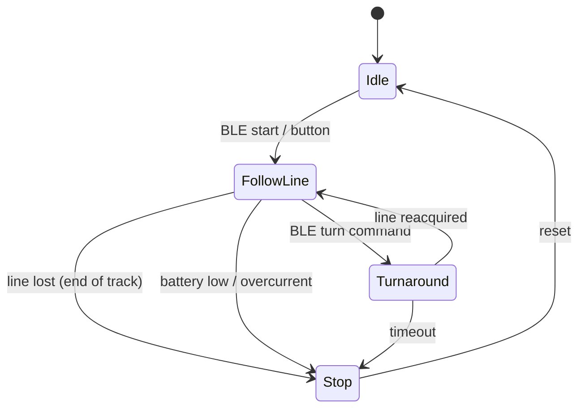

# ESP Buggy – System Architecture

> **Note:** need to ask how the turnaround and stop at end of race is implemented

## 1. System architecture

The buggy is built around an **STM32F401RE Nucleo**, which runs all the control software in a fixed-rate loop. Reads three inputs: the line sensors, the wheel encoders and the BLE module. It drives the two motors through the supplied **motor driver board**. The **9 V AA battery pack** powers only the driver board. An isolated DC-DC converter on the driver board supplies 5 V to the Nucleo and all the sensors.

### 1.1 Subsystems

| Subsystem | Hardware | Role | Interface to Nucleo |
|---|---|---|---|
| Line sensing | TCRT5000 reflective sensors, LEDs switched by a ULN2003A | Detect the white line's position under the buggy | ADC inputs; GPIO for LED enable |
| Speed sensing | Quadrature encoder on each motor shaft (256 CPR) | Measure wheel speed and direction | Timer in encoder mode (QEI) |
| Communication | HM-10 BLE module | Receive commands from a phone; send telemetry | UART |
| Processing | STM32F401RE Nucleo | Sensor processing, control loops, state machine | – |
| Motor drive | Motor driver board (H-bridge, unipolar or bipolar) | Convert PWM signals into motor voltage | PWM ×2, direction ×2, mode ×2, enable (JP1a) |
| Actuation | 2 × DC motor + gearbox | Drive the left and right wheels | Through the driver board |
| Power monitoring | Current sense and DS2781 battery monitor, both on the driver board | Measure motor current and battery state | ADC (current); 1-wire (battery) |
| Power | 9 V AA pack → driver board → isolated 5 V | Power the motors and all the logic | – |

### 1.2 Signal flow

1. The **line sensors** output an analogue voltage → the ADC → the line position error.
2. The **encoders** output A/B pulses → a timer counter → the wheel speed.
3. The **BLE module** sends UART commands → an interrupt → the state machine.
4. The **Nucleo** runs the steering and speed controllers → PWM duty and direction for each motor.
5. The **motor driver** switches battery voltage to each motor → the gearbox → the wheels.
6. The **driver board** returns motor current and battery data to the Nucleo for fault detection.

### 1.3 Power

| Rail | Source | Supplies | Limit |
|---|---|---|---|
| VBatt (≈9 V) | AA battery pack | H-bridge and motors | ~10 V, 1.8 A per motor channel |
| 5 V isolated | DC-DC on the driver board | Nucleo, line sensors, encoders, BLE | 400 mA total |
| 3.3 V | Nucleo regulator | MCU core and I/O | < 5 mA per GPIO pin |

### 1.4 Constraints

- The sensor LEDs are the largest load on the 400 mA rail, so they are switched through the ULN2003 and can be pulsed.
- The Nucleo's I/O is 3.3 V and its inputs are 5 V tolerant. The driver board accepts 3.3 V logic, so no level shifting is needed.
- The gear ratio must keep each motor's current under 1.8 A on slopes.
- The PWM frequency should sit above the audible range.
- The control loop runs at a constant sample time, `Ts`.

## 2. Finite state machine

| State | Behaviour | Exit condition → next state |
|---|---|---|
| Idle | Motors disabled; waiting | Start command → FollowLine |
| FollowLine | Steering + speed control active | Turn command → Turnaround; line lost or fault → Stop |
| Turnaround | Wheels driven in opposite directions until the line is found | Line reacquired → FollowLine; timeout → Stop |
| Stop | Brake, then disable the driver | Reset → Idle |
